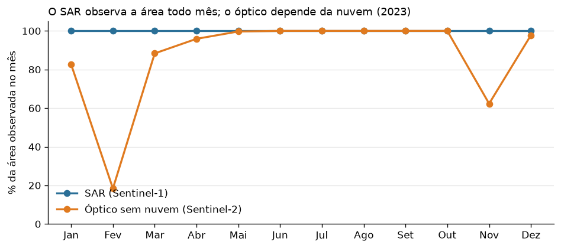
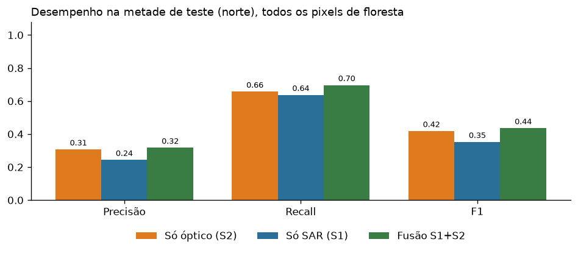
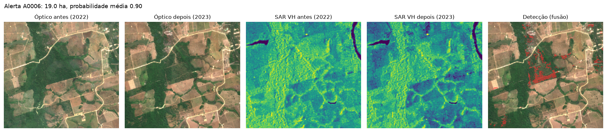

# Monitoramento de desmatamento com Sentinel-1 e Sentinel-2

Desenvolvi este estudo de caso pessoal ao longo de um fim de semana para demonstrar, de forma objetiva, meu interesse em contribuir com um time de visão computacional aplicada ao sensoriamento remoto. Investiguei quanto o radar Sentinel-1 pode acrescentar ao monitoramento de perda florestal quando imagens ópticas Sentinel-2 são limitadas por nuvens.

## Resultado principal

Na seca, o óptico já oferece observações úteis e a fusão acrescentou pouco à classificação: F1 de 0.436 contra 0.418 para o óptico. O valor operacional do radar aparece quando o óptico fica limitado: em Fev, o Sentinel-2 teve observação limpa em 18.4% da área, enquanto o Sentinel-1 observou 100.0% em média ao longo do ano. O modelo só com SAR encontrou cerca de 64% da perda Hansen na avaliação de seca (recall 0.637); o desempenho na estação chuvosa ainda não foi testado.



## O que implementei

- Composição mediana de estação seca para Sentinel-2 SR Harmonized, com máscara Cloud Score+, e Sentinel-1 GRD (VV e VH), comparando 2022-06-01 a 2022-10-31 com 2023-06-01 a 2023-10-31.
- Índices ópticos, variáveis SAR e diferenças entre os períodos.
- Rótulo Hansen Global Forest Change v1.12, considerando a floresta remanescente no início do período.
- Três Random Forests no Google Earth Engine: somente óptico, somente SAR e fusão.
- Holdout espacial: treino na metade sul e avaliação na metade norte, em vez de dividir aleatoriamente pixels vizinhos.
- Geração de alertas, imagens, tabelas, mapa HTML e pacote ZIP.

## Resultados na metade de teste

| Modelo | Precisão | Recall | F1 |
|---|---:|---:|---:|
| Só óptico (Sentinel-2) | 0.307 | 0.657 | 0.418 |
| Só SAR (Sentinel-1) | 0.244 | 0.637 | 0.352 |
| Fusão Sentinel-1 + Sentinel-2 | 0.317 | 0.697 | 0.436 |




O processamento gerou 127 polígonos candidatos, somando aproximadamente 1,165 ha. Na metade de teste, 95 alertas foram comparados com o rótulo Hansen; 40% tiveram pelo menos metade da área coincidente. Essa concordância não é confirmação independente de campo.

## Análise exploratória dos erros

Contei, sem ponderação de borda, os falsos positivos do modelo de fusão na metade de teste e comparei-os com a banda `lossyear` do Hansen e com a vizinhança dos pixels rotulados como perda em 2023. Dos 4,138 pixels classificados como falso positivo frente ao rótulo de 2023, 4,138 têm `lossyear=24` (perda registrada pelo Hansen em 2024). Desses, 316 também ficam a até um pixel de um pixel Hansen rotulado como perda de 2023; 3,822 têm perda registrada em 2024 fora dessa vizinhança. 0 ficam perto de perda de 2023 sem `lossyear=24`, e 0 não se enquadram em nenhuma das duas condições.

Esse padrão é compatível com um possível descompasso temporal do rótulo: parte dos falsos positivos pode corresponder a perda que o Hansen data em 2024, mas cuja mudança já era detectável nas imagens de 2023. A contagem não prova quando ocorreu a mudança nem confirma os pixels como desmatamento; a hipótese precisa de validação independente. Esta contagem inteira é exploratória e não é diretamente intercambiável com a matriz de confusão ponderada por área usada nas métricas principais.

## Reproduzir

### Pré-requisitos

- Python 3.10 ou superior e Git.
- Conta Google com acesso ao Earth Engine.
- Projeto Google Cloud autorizado para o uso pretendido no Earth Engine, com a Earth Engine API habilitada.
- Navegador na mesma máquina que executa o Jupyter, para concluir a autenticação local.

### Configurar o ambiente

Clone o repositório e crie um ambiente virtual:

```powershell
git clone https://github.com/laercio-siqueira-git/monitoramento-desmatamento-s1-s2.git
cd monitoramento-desmatamento-s1-s2
py -m venv .venv
.venv\Scripts\Activate.ps1
python -m pip install --upgrade pip
python -m pip install -r requirements.txt ipykernel
```

No macOS/Linux, use:

```bash
python3 -m venv .venv
source .venv/bin/activate
python -m pip install --upgrade pip
python -m pip install -r requirements.txt ipykernel
```

Abra `piloto_desmatamento_s1_s2.ipynb` e selecione o kernel da pasta `.venv`. Também é possível usar Google Colab com um projeto Earth Engine válido.

### Configurar o Earth Engine e executar

Na seção **1. Autenticação no Earth Engine**, defina `PROJECT_ID` com um projeto Google Cloud que a pessoa executora possa usar. Para evitar gravar o ID no notebook, configure a variável de ambiente `EE_PROJECT` antes de iniciar o Jupyter:

```powershell
$env:EE_PROJECT = "ID_DO_PROJETO_DA_EQUIPE"
```

No macOS/Linux:

```bash
export EE_PROJECT="ID_DO_PROJETO_DA_EQUIPE"
Contei, sem ponderação de borda, os falsos positivos do modelo de fusão na metade de teste e comparei-os com a banda `lossyear` do Hansen e com a vizinhança dos pixels rotulados como perda em 2023. Dos 4.138 pixels classificados como falso positivo frente ao rótulo de 2023, todos têm `lossyear=24` (perda registrada pelo Hansen em 2024). Desses, 316 também ficam a até um pixel de um pixel Hansen rotulado como perda de 2023; os outros 3.822 não ficam nessa vizinhança.

Execute as células em ordem, de cima para baixo. Na primeira autenticação local, o navegador solicitará consentimento com escopo somente de leitura do Earth Engine. Confirme a conta e as permissões; não compartilhe tokens, códigos de autorização ou credenciais. A execução completa pode levar de 10 a 25 minutos.

## Parâmetros ajustáveis

- Este experimento avalia uma área e um ano; não demonstra desempenho generalizável para toda a Amazônia.
- A comparação dos modelos usa composições da estação seca. A disponibilidade mensal de observações não prova que a fusão aumenta a acurácia na estação chuvosa.
- O rótulo Hansen tem resolução de 30 m e pode incluir perda por fogo. A validação com referência independente, como PRODES/DETER ou amostras revisadas, é um próximo passo.
- Os pontos de treino são balanceados por classe; as probabilidades não devem ser interpretadas automaticamente como probabilidades calibradas para a prevalência real de desmatamento.
- Os polígonos são alertas candidatos para revisão, não confirmações de campo.

## Dados e créditos

- Sentinel-1 e Sentinel-2: dados Copernicus processados no Google Earth Engine.
- Cloud Score+: Pasquarella et al. (2023), CVPR Workshops.
- Hansen Global Forest Change v1.12: Hansen et al. (2013), *High-Resolution Global Maps of 21st-Century Forest Cover Change*, *Science* 342, 850–853.

## Autor

Laércio Siqueira, cientista de dados.
